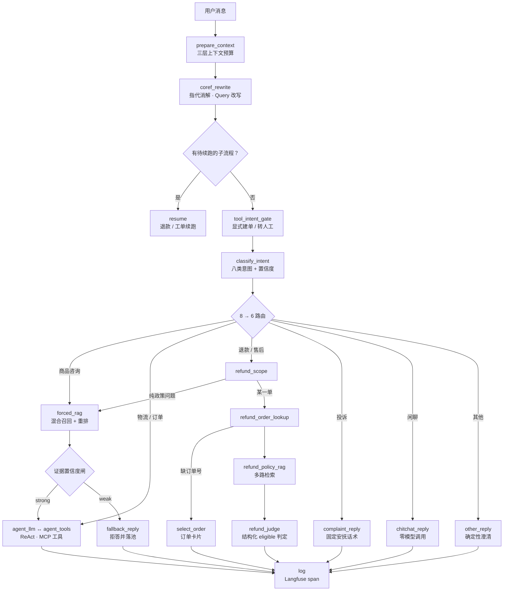
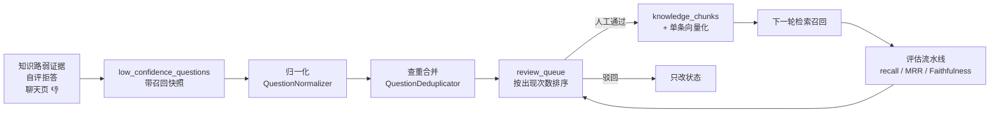

# 电商售后智能客服

> 一个把「答不准就拒答、拒答就变成知识」写进主链路的售后客服系统：八类意图确定性分流、证据置信度闸挡住弱证据、人工审核后的知识自动回流检索，全链路可观测、可回归评估。


---

## 这是什么

一个可以直接跑起来的电商售后客服后端 + 完整前端界面。用户侧能查订单、查物流、走退款/退货流程、转人工；运营侧有一个审核台和一个飞轮看板，把客服答不上来的问题变成知识库条目。

它不是一个「把问题丢给大模型」的 demo。整个设计围绕三个判断：

**1. 能写死的地方不交给模型。** 投诉和闲聊是零模型调用的固定出口；「帮我建工单」「转人工」这类显式指令由正则闸门直接拦截，跳过意图分类；意图识别只输出八类之一加一个置信度，低置信直接归「其他」并给固定澄清话术——宁可追问，也不猜。

**2. 检索结果先过闸，再决定要不要答。** 知识类问题强制检索，命中后先算一个组合置信度（Top1 分数、与第二名的差距、有效证据条数），不足阈值就拒答、把问题落进低置信池。回答用 `[n]` 角标标注依据，可回溯到具体知识块。

**3. 拒答不是终点，是燃料。** 低置信问题、自评拒答、用户点👎，三个入口都落到同一张池表并附带召回快照；后台做归一化和查重，进入审核队列；人工通过后写回知识库并向量化，下一轮就能被检索到。评估流水线再把 recall / MRR / Faithfulness 记进 `eval_runs`，形成可量化的闭环。

## 界面

### 顾客端


三栏布局：左侧会话历史，中间对话，右侧服务范围。回答带引用角标 `[1][2][3]`，底部是「有用 / 没用」反馈——点👎会触发数据飞轮。

<table>
<tr>
<td width="50%"></td>
<td width="50%"></td>
</tr>
<tr>
<td><sub><b>审核台</b>：左侧队列按出现次数排序，右侧看用户原话、来源入口和召回 Top 片段，通过即写回知识库。</sub></td>
<td><sub><b>数据飞轮</b>：落池 → 归一 → 过审 → 复测四道工序的实时计数，右下是最近一轮评估的 recall@10 / MRR / Faithfulness。</sub></td>
</tr>
</table>

## 架构

### 一轮对话的主链路



两条容易被问到的设计：

- **知识类走「先检索、后生成」**：`forced_rag` 把编号证据交给 Agent，提示词要求只用这些证据作答、用 `[n]` 标注出处、不再自行调 FAQ；证据不够则在生成前直接短路，省掉一次幻觉。
- **退款/售后不是一条 Prompt**：先判定问题对象是政策还是某一单；是某一单就查订单、缺订单号发选择器、判定可处理才发退款表单；换货换新转售后工单。整条路径是可枚举的状态机，不是让模型自由发挥。

### 数据飞轮



### 目录结构

```
app/
  api/            接口层：对话 / 会话 / 审核 / 评估 / 认证
  graph/          LangGraph 图：节点、路由、coref、意图、退款子流程
  knowledge/      检索：切分、嵌入、Milvus、BM25、重排、证据闸、自检
  flywheel/       数据飞轮：归一化、查重、单 worker 队列
  tools/          工具注册中心、内置工具、插件热加载
  services/       会话、退款、工单、工具执行、审计、评估流水线
  db/             SQLAlchemy 模型与仓储
  evaluation/     评估数据集、指标、LLM 裁判、趋势
  prompts/        14 个 prompt 模板
  static/         聊天页 / 审核台 / 飞轮页（原生 HTML + CSS + JS，无构建）
evals/            标注评估集与评估脚本
scripts/          建库、挖矿、校准、成本报告、端到端验收
mcp_servers/      物流 / 售后两个 FastMCP Server（Streamable HTTP）
sql/              逐章 DDL
docs/             安装配置、API、评估、变更日志、已知限制
tests/            单元测试 + 集成测试（85 个文件）
```

## 量化结果

| 维度 | 指标 | 结果 |
|---|---|---|
| 测试 | `uv run pytest -m "not integration"` | **772 passed, 33 deselected** |
| 检索质量 | 48 条标注集：Recall@1 / Recall@3–10 / MRR | **0.900 / 1.000 / 0.950** |
| 答案忠实度 | Faithfulness（LLM 裁判，同一评估集） | **1.000** |
| 证据闸校准 | balanced accuracy / F1 / 不可答被误接受 | **0.9375 / 0.9333 / 0 of 8** |
| 摘要质量 | 4 条标注样例（事实保留、无编造、寒暄不留、长度） | **4 / 4** |
| 回归能力 | 评估结果落 `eval_runs`，可输出轮次 Δ 与趋势 | 已接入审核台 |

> 这些数字的用途是**回归与策略对比**，不是线上质量承诺：数据集 48 条覆盖有限，Faithfulness 由 LLM 裁判而非金标准，模型本身有非确定性。完整口径见 [docs/evaluation.md](docs/evaluation.md)。

## 快速上手

需要 Python 3.11+、MySQL 9.x 和一个 OpenAI 兼容的上游（默认 DeepSeek）。嵌入与重排默认用 SiliconFlow 的 BGE-M3。

```bash
# 1. 依赖
uv sync

# 2. 数据库：基础表 + 逐章迁移
mysql -h 127.0.0.1 -u root -p -e "CREATE DATABASE IF NOT EXISTS ecom_customer_service DEFAULT CHARACTER SET utf8mb4"
mysql -h 127.0.0.1 -u root -p ecom_customer_service < db/schema.sql
mysql -h 127.0.0.1 -u root -p ecom_customer_service < db/seed.sql
for f in sql/ch03-ddl.sql sql/ch04-ddl.sql sql/ch06-ddl.sql sql/ch07-ddl.sql sql/ch07-layers.sql sql/ch08-ddl.sql sql/ch09-ddl.sql; do
  mysql -h 127.0.0.1 -u root -p ecom_customer_service < "$f"
done

# 3. 配置：至少填 OPENAI_API_KEY、EMBED_API_KEY、RERANK_API_KEY
test -f .env || cp .env.example .env

# 4. 建知识库（离线，需嵌入 key）
uv run python scripts/build_knowledge.py

# 5. 起服务（Milvus Lite 单进程，固定 --workers 1）
uv run uvicorn app.main:create_app --factory --host 127.0.0.1 --port 8000 --workers 1
```

打开 <http://127.0.0.1:8000>：顾客账号在 `/register` 自助注册；管理员账号由系统内置，默认 `admin / admin1234`（`ADMIN_PASSWORD` 可改），从 `/admin/login` 进入审核台。

需要 MCP 工具（物流 / 售后）时另开两个终端：

```bash
make mcp-logistics
make mcp-aftersales
```

完整的环境变量说明、Docker 方式、逐章配置项见 [docs/setup.md](docs/setup.md)。

## 能力总表

| 章节 | 能力 | 一句话 |
|---|---|---|
| CH01 | 纯聊天基线 | SSE 流式对话，售后结构化抽取 |
| CH02 | Function Calling | 订单 / 物流 / FAQ / 建单工具链 + SSE 事件协议 |
| CH03 | 知识库 | Markdown 切分 + BGE-M3 嵌入 + Milvus，对话挖矿入库 |
| CH04 | 检索质量 | BM25 + dense 混合召回 + `bge-reranker-v2-m3`，引用可回溯 |
| CH05 | Workflow 编排 | LangGraph 图 + ReAct Agent，投诉/闲聊确定性出口 |
| CH06 | 分流器 | coref 改写 + 八类意图 + 8→6 路由 + 退款状态机 |
| CH07 | 上下文管理 | 三层压缩 + 窗口倒推预算 + 后台分段摘要 |
| CH08 | 工具系统 | ToolSpec 注册中心、Schema 校验、权限门禁、超时重试、审计、MCP |
| CH09 | 可观测与飞轮 | Langfuse 链路、证据闸、低置信池、审核台、评估流水线 |
| CH10 | 账号与界面 | 顾客/管理员双入口、会话级鉴权、界面改版 |

每一章的详细实现、接口变化和踩坑记录在 [docs/changelog.md](docs/changelog.md) 与 [dev-notes/](dev-notes/)。

## API 一览

| 方法 | 路径 | 说明 |
|---|---|---|
| POST | `/api/chat/stream` | SSE 流式对话：`session` → `tool` / `citations` / `actions` → `token` → `done` |
| POST | `/api/chat/resume` | 工单预览卡的确认 / 取消（`Command(resume=...)`） |
| GET | `/api/chat/pending` | 刷新后恢复未决预览 |
| POST | `/api/agent` | 非流式图入口，返回工具轨迹，供评估使用 |
| POST | `/api/chat/extract` | 售后结构化抽取 |
| GET | `/api/conversations` | 会话列表：首问预览、是否已摘要、最后消息时间 |
| GET | `/api/conversations/{id}/messages` | 某会话的 user/assistant 历史原文 |
| POST | `/api/actions/submit-refund` | 退款表单提交，写 `refund_requests` |
| POST | `/api/actions/create-ticket` | 建工单，写 `tickets` |
| POST | `/api/feedback` | 👎 落低置信池并尝试入飞轮 |
| GET / POST | `/api/review-queue[/{id}]` | 待审队列、详情、通过、驳回 |
| GET | `/api/eval-runs[/trend]` | 评估轮次与三指标 Δ |
| POST | `/api/auth/register` `/login` `/logout` | 账号体系 |

完整的请求体、SSE 事件字段与 curl 示例见 [docs/api.md](docs/api.md)。

## 测试与评估

```bash
# 单元测试（不访问网络）
uv run pytest -m "not integration"

# 全量（配置了真实 key 时会跑集成测试）
uv run pytest

# 检索评估：48 条标注集，输出 Recall@K / MRR / Faithfulness
uv run python evals/run_ch04_eval.py

# 评估流水线：结果落 eval_runs，并与上一轮比 Δ（需先停服务）
make eval-ch09 && make eval-ch09-trend
```

全部评估与验收脚本（包括各章的端到端验收）见 [docs/evaluation.md](docs/evaluation.md)。

## 已知边界

- **订单 / 商品 / 物流是 mock 数据**，不接真实电商系统；固定演示订单只有 1001–1003。
- **Milvus Lite 单进程**：建库、评估、补偿脚本和审核向量化都不能与服务同时打开本地文件；服务固定 `--workers 1`。
- **飞轮单 worker**：进程内 `asyncio.Queue`，重启会丢未处理项，靠 `matched_review_id IS NULL` + `backfill_flywheel.py` 补偿。
- **没有限流和计费**，默认只监听 `127.0.0.1`，不要直接暴露公网。
- 置信度阈值 0.50 只在知识路校准过，退款路沿用同一阈值但未单独校准。
- 评估集 48 条覆盖有限，数字用于回归，不代表线上绝对质量。

完整清单见 [docs/known-limitations.md](docs/known-limitations.md)。

## 文档

| 文档 | 内容 |
|---|---|
| [docs/setup.md](docs/setup.md) | 安装、数据库、环境变量、切换上游模型 |
| [docs/api.md](docs/api.md) | 接口清单、SSE 事件协议、curl 示例 |
| [docs/evaluation.md](docs/evaluation.md) | 测试策略、评估脚本、逐章验收步骤 |
| [docs/changelog.md](docs/changelog.md) | 分章变更记录（CH02–CH09） |
| [docs/known-limitations.md](docs/known-limitations.md) | 逐章累积的已知限制 |
| [dev-notes/](dev-notes/) | 每章的开发过程记录与验收截图 |
| [docs/superpowers/specs/](docs/superpowers/specs/) | 每章的设计规格 |
| [PROGRESS.md](PROGRESS.md) | 最近的进度与交付说明 |